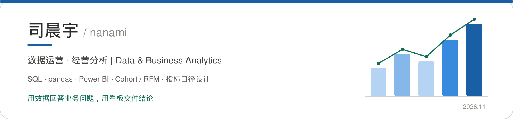
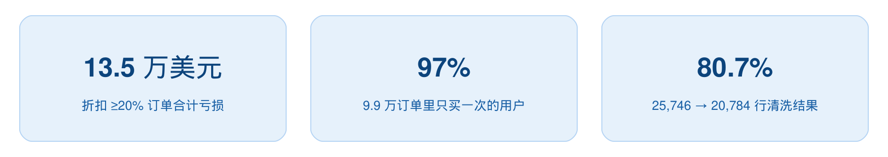

  
    
  <b>司晨宇（nanami）</b> · 数据运营 / 经营分析
   
  <i>把业务问题拆成可验证的结论，再落成能交付的看板</i>
    
  
  
  
  
   
  
  
  
  

---

### 关于我

> 独立完成 4 个数据分析项目（含 1 个自造取数工具）；擅长 SQL 口径设计与 Cohort / RFM 分析，习惯把结论落成可监控的指标和能交付的看板，而不是停在图表上。

### 精选项目

<table>
  <tr>
    <td width="50%" valign="top">
      <b>01 · <a href="https://github.com/nanamisaigao/superstore_bi">零售折扣—利润诊断</a></b> 
      4 年、9,994 行订单：销售额 +20.4%，毛利率为什么反降？  
      折扣 ≥20% 的订单只占 GMV <b>15.8%</b>，却亏掉 <b>13.5 万美元</b>；40%+ 折扣区间毛利率 <b>-77.4%</b>；家具品类仅 <b>2.49%</b>。 
      交付：Power BI 交互看板 + Excel 一页纸月报 + 折扣审批建议 
      CSV → MySQL → Power BI → Excel｜Python · SQL
    </td>
    <td width="50%" valign="top">
      <b>02 · <a href="https://github.com/nanamisaigao/sql_olist">用户留存诊断与二次触达</a></b> 
      9.9 万订单里 97% 用户只买一次：继续拉新，还是做存量？  
      15 个首购批次次月留存仅 <b>0.18%–0.72%</b> 且无改善，复购率 <b>3.0%</b> → 判断为「首购即终点」的一次性交易；GMV 与支付流水对账一致率 <b>99.98%</b>。 
      交付：Cohort 留存矩阵 + 8 类客群 + A/B 触达方案 + 多 Sheet 报表 
      CTE · 窗口函数 · NTILE｜SQLite · pandas · openpyxl
    </td>
  </tr>
  <tr>
    <td width="50%" valign="top">
      <b>03 · <a href="https://github.com/nanamisaigao/SQL-Agent">SQL-Agent：自然语言取数工具</a></b> 
      做上面两个项目时反复手写取数 SQL，于是自己造了一个。  
      <b>200 行手写 Agent 循环</b>，未用任何框架：拼表结构 → 调模型 → pydantic 校验 → 执行 → 结果回灌；FastAPI + SSE 一条事件流同时驱动 CLI 与浏览器前端。 
      SQLite 只读连接、只放行单条 SELECT；25 条用例一次通过 <b>20 条</b>。 
      Python · FastAPI · pydantic · typer · 原生 ES Module
    </td>
    <td width="50%" valign="top">
      <b>04 · <a href="https://github.com/nanamisaigao/pandas_bill">pandas 账单清洗工具</a></b> 
      从脏数据到月度报表，一条完整链路。  
      20 类脏数据规则化清洗，<b>25,746 → 20,784 行（保留 80.7%）</b>，输出月度分类报表、预算对比与 3 张趋势图。 
      覆盖「生成脏数据 → 体检 → 清洗 → 统计报表」全流程。 
      Python · pandas · Matplotlib · openpyxl
    </td>
  </tr>
</table>

每个项目的 README 都写了口径说明、假设与局限 —— 比结论本身更能说明我怎么干活。

其他仓库：[sql_bill](https://github.com/nanamisaigao/sql_bill)（SQLite 账单查询）· [CSV-Billing-Stats](https://github.com/nanamisaigao/CSV-Billing-Stats)（标准库 CSV 分析）· [todo-cli](https://github.com/nanamisaigao/todo-cli)（终端待办）

### 工具箱

| 方向 | 具体能力 |
| :--- | :--- |
| **SQL** | MySQL / SQLite；多表 JOIN、CTE、窗口函数（NTILE）、去重聚合、指标口径设计；能独立完成取数到报表全流程 |
| **Python** | pandas（清洗 / 分组聚合 / 透视 / 多表合并）、Matplotlib、openpyxl 多 Sheet 报表 |
| **BI / Excel** | Power BI（Power Query、KPI 卡、趋势 / 对比图、切片器）；Excel 透视表 / 透视图、XLOOKUP / SUMIFS |
| **分析方法** | GMV / 客单价 / 复购率 / 留存率口径，Cohort 留存、RFM 分层、漏斗与 A/B 测试设计、折扣—利润拆解 |
| **工程** | FastAPI + SSE、pydantic 校验、typer CLI、SQLite 只读连接、原生 ES Module 前端 |

### 看板与工具实拍

以下截图均来自对应项目仓库，点开可看大图。

<table>
  <tr>
    <td align="center" width="50%"> Power BI 交互看板</td>
    <td align="center" width="50%"> Excel 一页纸月报</td>
  </tr>
  <tr>
    <td align="center" width="50%"> Cohort 留存矩阵</td>
    <td align="center" width="50%"> SQL-Agent 网页界面</td>
  </tr>
</table>

### 联系

**邮箱**：[si_chenyv@163.com](mailto:si_chenyv@163.com)

---

最后更新：2026.11
