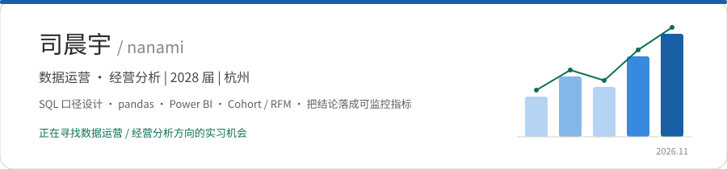

  
    
  
  
  
  
  
<b>司晨宇（nanami）</b> · 数据运营 / 经营分析 · 2028 届 · 杭州 
  <b>正在找数据运营 / 经营分析方向的实习</b> · 可全职实习至 2027.5（每周 5 天）· 随时到岗、随时线下面试

---

### 关于我

> 独立完成 4 个数据分析项目（含 1 个自造取数工具）；擅长 SQL 口径设计与 Cohort / RFM 分析，习惯把结论落成可监控的指标和能交付的看板，而不是停在图表上。

**三个能说明问题的数字**

- 折扣 ≥20% 的订单只占 GMV 15.8%，却亏掉 **13.5 万美元**；40%+ 折扣区间毛利率 **-77.4%**
- 9.9 万订单里 **97% 用户只买一次**，次月留存 0.18%–0.72% 且无改善 → 判断为「首购即终点」的一次性交易，而非「漏桶」
- 20 类脏数据规则化清洗，**25,746 → 20,784 行（保留 80.7%）**，输出月度报表与 3 张趋势图

### 工具箱

| 方向 | 具体能力 |
| :--- | :--- |
| **SQL** | MySQL / SQLite；多表 JOIN、CTE、窗口函数（NTILE）、去重聚合、指标口径设计；能独立完成取数到报表全流程 |
| **Python** | pandas（清洗 / 分组聚合 / 透视 / 多表合并）、Matplotlib、openpyxl 多 Sheet 报表 |
| **BI / Excel** | Power BI（Power Query、KPI 卡、趋势 / 对比图、切片器）；Excel 透视表 / 透视图、XLOOKUP / SUMIFS |
| **分析方法** | GMV / 客单价 / 复购率 / 留存率口径，Cohort 留存、RFM 分层、漏斗与 A/B 测试设计、折扣—利润拆解 |
| **工程** | FastAPI + SSE、pydantic 校验、typer CLI、SQLite 只读连接、原生 ES Module 前端 |

### 项目

#### 01 · 零售折扣—利润诊断与经营看板

> 4 年、9,994 行零售订单：销售额 +20.4%，毛利率却从 13.43% 掉到 12.74%，钱去哪了？

- **结论**：折扣 ≥20% 的订单只占 GMV 15.8%，合计亏损 13.5 万美元；40%+ 区间毛利率 -77.4%；家具毛利率仅 2.49%（目标 10%）；Central 7.9% 不到 West 14.9% 的六成
- **交付**：Power BI 交互看板 + Excel 一页纸月报（6 张 KPI 卡、3 条结论，公式实时计算）+ 折扣审批建议
- **链路**：CSV → MySQL 8.0 → Power BI → Excel，全部口径集中在一张「汇总」表，改一处全表更新
- [superstore_bi](https://github.com/nanamisaigao/superstore_bi) · Python / SQL / Power BI / Excel

#### 02 · 电商用户留存诊断与二次触达

> 9.9 万订单、9.3 万客户，97% 的用户只买一次：预算该继续拉新，还是做存量？

- **结论**：15 个首购批次次月留存 0.18%–0.72% 且无改善，复购率 3.0%；GMV 1,541 万 BRL 与支付流水对账一致率 99.98%；「重要发展客户」占 34.7%，是唯一有拉动空间的群体
- **方法**：原生 SQL 做 GMV 口径核算、Cohort 留存矩阵（分母用各批次首购人数）、RFM 分层；因 97% 用户频次为 1，F 维度改用业务阈值而非 NTILE
- **交付**：留存矩阵 + 8 类客群 + A/B 测试方案（首购后 30 天二次触达，以 30 天二购率验收）+ 多 Sheet Excel 报表
- [sql_olist](https://github.com/nanamisaigao/sql_olist) · SQLite / SQL / pandas / openpyxl

#### 03 · SQL-Agent：给自己用的自然语言取数工具

> 做上面两个项目时反复手写取数 SQL，于是边分析边把它造了出来，现已用它完成两个项目的取数与初筛。

- **实现**：200 行手写 Agent 循环（拼表结构 → 调模型 → pydantic 校验工具调用 → 执行 → 结果回灌），**未使用任何 Agent 框架**；FastAPI + SSE 一条事件流同时驱动 CLI（typer，11 条子命令）与浏览器前端（原生 ES Module，无构建步骤）
- **安全与验证**：SQLite 只读连接、只放行单条 SELECT，模型只读不写；25 条用例一次通过 20 条，失败集中在 JOIN 选表与聚合粒度
- [SQL-Agent](https://github.com/nanamisaigao/SQL-Agent) · Python

#### 04 · pandas 账单清洗工具

> 从脏数据到月度报表，一条完整链路。

- 20 类脏数据规则化清洗，25,746 → 20,784 行（保留 80.7%），输出月度分类报表、预算对比与 3 张趋势图
- 覆盖「生成脏数据 → 体检 → 清洗 → 统计报表」全流程
- [pandas_bill](https://github.com/nanamisaigao/pandas_bill) · Python / pandas

其他仓库：[sql_bill](https://github.com/nanamisaigao/sql_bill)（SQLite 账单查询）· [CSV-Billing-Stats](https://github.com/nanamisaigao/CSV-Billing-Stats)（标准库 CSV 分析）· [todo-cli](https://github.com/nanamisaigao/todo-cli)（终端待办）

### 看板与工具实拍

<table>
  <tr>
    <td align="center" width="50%"> Power BI 交互看板</td>
    <td align="center" width="50%"> Excel 一页纸月报</td>
  </tr>
  <tr>
    <td align="center" width="50%"> Cohort 留存矩阵</td>
    <td align="center" width="50%"> SQL-Agent 网页界面</td>
  </tr>
</table>

### 背景

郑州工程技术学院 · 智能建造 · 本科（2028 届）｜主修 Python 程序设计、概率与数理统计、云计算与大数据技术
校级「C 语言学习能手」；曾组织新生 C 语言培训、电脑义修

### 联系

**邮箱**：[si_chenyv@163.com](mailto:si_chenyv@163.com)

欢迎直接看项目 README——每个项目都写了口径说明和局限，比结论本身更能说明我怎么干活。

---

最后更新：2026.11
